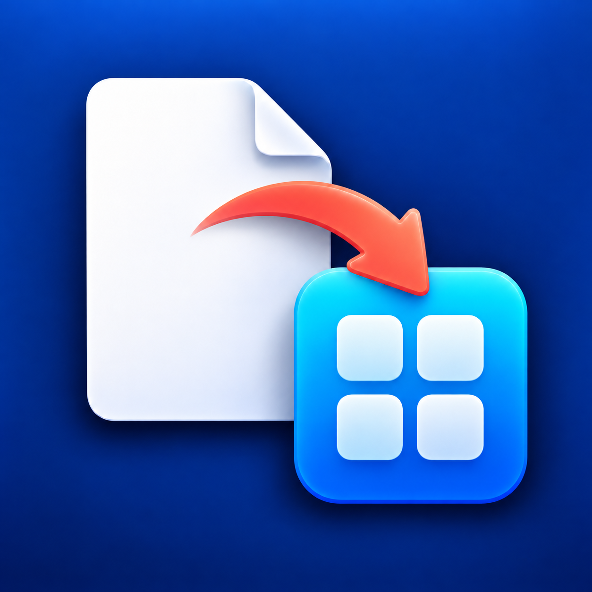
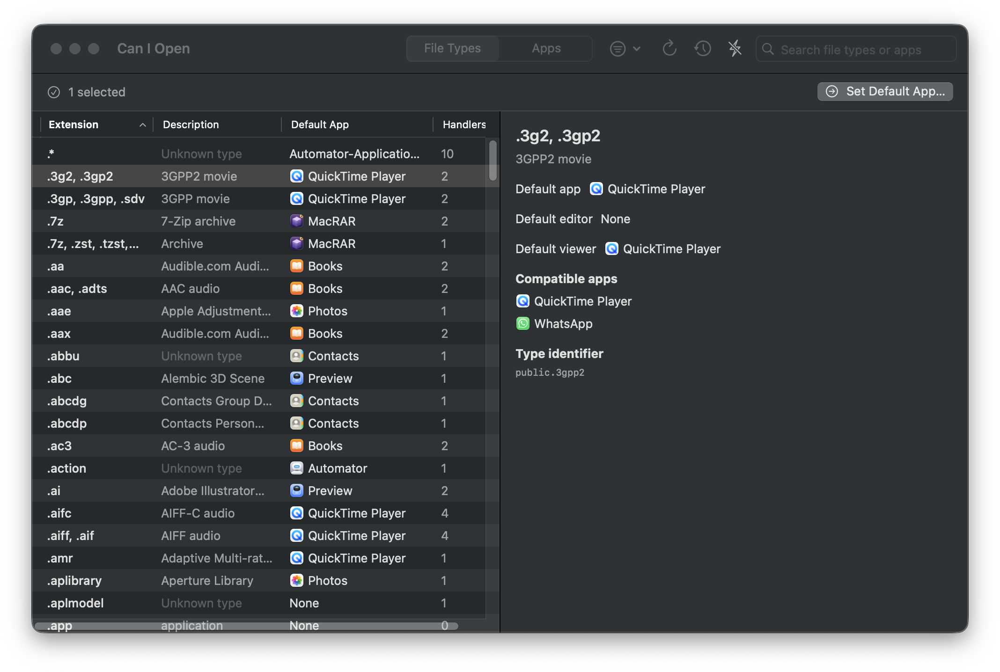
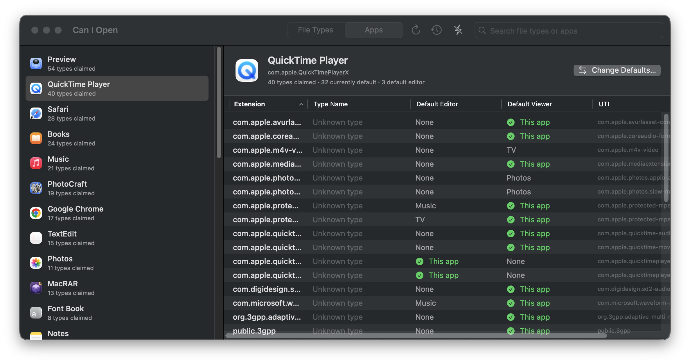
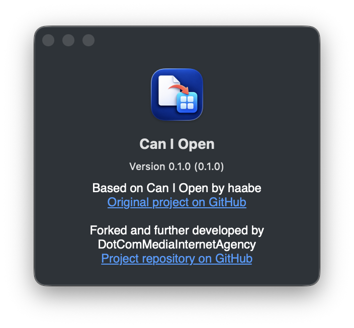

<div align="center">
  
  <h1>Can I Open</h1>
  <p><strong>Take control of your macOS file associations.</strong></p>
  <p>A native Mac utility for seeing which apps claim your file types and changing defaults in batches.</p>
  <p>
    
    
    <a href="LICENSE"></a>
  </p>
  <p>Based on <a href="https://github.com/haabe/can-i-open">haabe’s original project</a>; maintained as a fork by <a href="https://github.com/DotComMediaInternetAgency">DotComMediaInternetAgency</a>.</p>
</div>

<p align="center">
  
</p>

## Why Can I Open?

Apps can register as handlers for dozens of file types, and macOS does not provide a convenient way to review or change those defaults in bulk. Can I Open gives you one place to inspect file types and installed apps, understand current handlers, and make deliberate changes.

## What you can do

- **Browse file types:** Search and sort by extension, description, default app, handler count, or UTI. Filter for types without a default or with multiple handlers.
- **Inspect installed apps:** See the types an app declares and which defaults currently point to it.
- **Change defaults in batches:** Select file types and choose one target app. Recommended apps that handle every selected type appear first. In the app-to-app flow, supported types are selected by default; unsupported types are identified and require an explicit choice.
- **Review and undo changes:** See results and failures for a batch and undo successful changes during the current app session.
- **Refresh automatically:** Detect LaunchServices association changes and refresh the displayed defaults.
- **Optionally confirm macOS dialogs:** On macOS 26.4 and later, enable Accessibility-based auto-confirm for supported confirmation dialogs.

## Screenshots

<p align="center">
  
</p>

<p align="center">
  
</p>

## Build from source

### Requirements

- macOS 13 (Ventura) or later
- Swift 5.9 or a compatible Xcode toolchain
- No third-party package dependencies

### Build and run

```sh
git clone https://github.com/DotComMediaInternetAgency/can-i-open.git
cd can-i-open

# Build and launch the debug app
make debug

# Build the release app bundle without launching it
make build
```

The app bundle is created at `.build/Can I Open.app`. See [docs/DEVELOPMENT.md](docs/DEVELOPMENT.md) for local installation guidance and [docs/TESTING.md](docs/TESTING.md) for validation practices.

## Important behavior

- Changing a default affects macOS LaunchServices settings outside the app. macOS may ask you to confirm each change.
- macOS may refuse a file type assignment when the selected app does not declare support for that type; even if accepted, the app may not open it correctly.
- The modern macOS API sets the default app for opening a content type. Editor and viewer handlers are displayed separately, but a new assignment does not set those roles independently.
- Change history is kept only until you quit the app. Undo cannot restore a role that was previously empty.
- Auto-confirm is optional and requires the user to grant Can I Open Accessibility permission in System Settings.
- Can I Open does not send usage data or telemetry over the network.

## Developer documentation

The project’s development standards and design notes are in [`docs/`](docs/README.md). Start with [`AGENTS.md`](AGENTS.md) and [`CONTRIBUTING.md`](CONTRIBUTING.md).

## Credits and license

Can I Open is based on [haabe’s original project](https://github.com/haabe/can-i-open). This fork is maintained by [DotComMediaInternetAgency](https://github.com/DotComMediaInternetAgency/can-i-open). The app’s standard About panel includes links to both repositories.

Distributed under the [MIT License](LICENSE).
